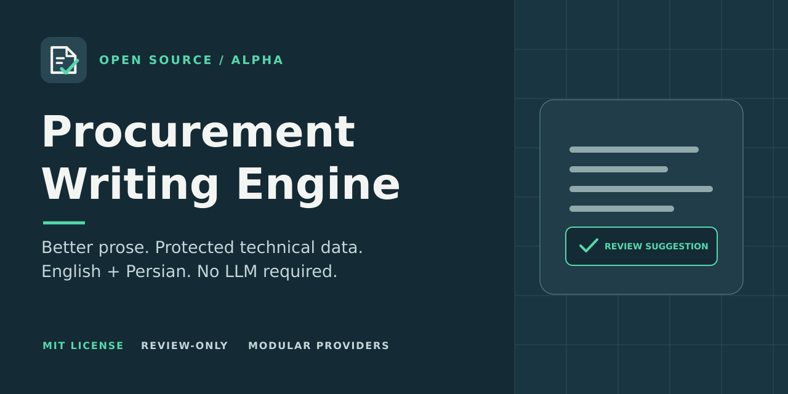

<p align="center"></p>

# Procurement Writing Engine

**Better prose. Protected technical data.**

[English](README.md) · [فارسی](docs/README.fa.md)

[](https://github.com/FireXCore/procurement-writing-engine/actions/workflows/ci.yml)


An independent, review-only writing-assistance integration library for procurement and technical commercial prose. It composes existing open-source engines instead of reimplementing their grammar parsers. English and Persian, no large language model, no automatic mutation. **Alpha-stage library. Not qualified for production use.**

## Architecture

```text
Host-owned authorized snapshot + complete region map
                         |
               Region admission (fail closed)
                         |
            Single bounded analysis orchestrator
               /                         \\
     Local/browser profile            Optional document QA profile
     Harper + Virastar                Vale / LanguageTool / STE100
     Reviewed Textlint rules           (trusted local host only)
               \\                         /
        Normalized source-anchored proposals (UTF-16)
                         |
       Grapheme / span / replacement validation + provenance
                         |
             Immutable review report — NO APPLY
```

The default recommended deployment profile is Harper for English and Virastar for Persian. Textlint adds reviewed organization-specific language policies. Vale checks style/terminology, STE100 checks technical English and LanguageTool adds optional self-hosted checks. The experimental TypeScript Virastar fork is a separate advisory adapter, not a default dependency. None of these engines can authorize changes to procurement records. Provider composition is explicit; a heavyweight server stack is not required for browser-only use.

## Installation from a verified GitHub release

After the required CI gates pass and a prerelease appears on [GitHub Releases](https://github.com/FireXCore/procurement-writing-engine/releases), download the alpha tarball and `SHA256SUMS.txt`, verify the checksum, then install the local file. Public source alone does not indicate that a release artifact has passed qualification. The package is not published to the npm registry.

```sh
npm install ./procurement-writing-engine-0.1.0-alpha.2.tgz
npm install --save-exact harper.js@3.2.0 virastar@0.22.1
```

Install the Textlint peer packages only when using that provider. Optional Node services are installed separately and must be qualified by the host.

## Run the local contract suite

Requires Node.js 22.12+ (tested with Node.js 22.16.0). The contract suite needs no third-party installation:

```sh
npm run check
npm test
```

For actual upstream JS execution (after a real lockfile has been generated during release bootstrap):

```sh
npm ci --ignore-scripts
npm run verify
node examples/review.mjs
```

See [release gates](docs/RELEASE.md) for external services and browser/domain qualification. No upstream binaries, WASM, models or data are included. These commands require registry access and an installed Chromium browser. See [local evidence](docs/LOCAL_VERIFICATION.md) for the checks actually executed during authoring.

## Public API (review-only)

```js
import { binaryInlined } from 'harper.js/binaryInlined';
import { createEngine, createHarper, createVirastar } from './src/index.mjs';

// Node evaluation uses LocalLinter. A qualified browser host should own/terminate a Worker.
const harper = await createHarper({ binary: binaryInlined, worker: false });
const engine = createEngine([harper.provider, await createVirastar()]);
const prose = 'Please send teh quotation for ';
const technical = 'Rosemount 3051 — 3 PCS';
const text = prose + technical;
try {
  const result = await engine.analyze({
    text,
    snapshotId: 'synthetic:1',
    regions: [
      { start: 0, end: prose.length, kind: 'prose', language: 'en' },
      { start: prose.length, end: text.length, kind: 'protected' }
    ]
  });
  // Example only. Production must not log customer text or findings.
  console.log(result.status, result.findings);
} finally {
  await harper.dispose();
}
```

Region offsets are UTF-16, half-open, sorted, contiguous, nonoverlapping and cover the **entire exact source**. A `prose` region must have language `en` or `fa`; protected ranges never reach providers. The host is responsible for authoritative classification, including plain-letter brand/supplier names and commercial or technical facts. The library refuses missing/incomplete regions and conservatively skips obvious suspicious content even inside an admitted prose region. It is not a replacement for a host authorization system or a complete industrial parser.

Each finding contains provider, rule, category, absolute source range, exact original, plain-text message, and optional replacement. `apply` is always `false`. Conflicting suggestions remain separate. `complete` means the admitted work completed within the contract; it does not mean all grammar errors were found or the text is semantically safe. `partial` means limits, skipped regions or failed/invalid providers reduced coverage. `blocked`, `busy` and `cancelled` return no findings. The consumer must compare the returned `snapshotId` to its live authenticated scope and exact source before presenting proposals; it must discard stale results. Do not use analysis as authorization.

## Files and responsibilities

| Path | Responsibility |
|---|---|
| `src/engine.mjs` | Bounded provider composition, cancellation, immutable reports |
| `src/regions.mjs` | Complete-map verification, grapheme/offset conversion, conservative proposal gates |
| `src/adapters/` | Actual upstream interface adapters (Harper, Virastar JS/TS, Textlint, Vale, STE100, LanguageTool) |
| `src/node/` | Explicit optional local HTTP/process transports, no shell |
| `src/policy.mjs`, `styles/Procurement/` | Small example organization-owned delivery clarity policy, advisory only |
| `test/` | Core, actual transport with synthetic fixtures, real upstream acceptance suites |
| `docs/UPSTREAM_AUDIT.md` | Source references, exact reviewed releases, findings and limitations |
| `docs/RELEASE.md` | Qualification, GitHub publication and host integration gates |

This library is independent of any private ERP/Procurement application. See [security boundaries](SECURITY.md) and [third-party software](THIRD_PARTY.md) before distributing or installing upstream dependencies.

## Local demo and documentation

Run `npm run demo` after installing locked dependencies. The demo uses actual local browser providers in a dedicated Worker; it is not a production UI. Use the supplied synthetic samples only.

[Architecture](docs/ARCHITECTURE.md) · [API](docs/API.md) · [Release process](docs/RELEASE.md) · [Contributing](CONTRIBUTING.md) · [Changelog](CHANGELOG.md)



### Alpha.2 acceptance changes

The demo detects English/Persian automatically, explains partial results, and splits a limited set of synthetic technical patterns into protected ranges. This demo classifier is **not** a production parser. The library's host-authoritative region map remains mandatory. Harper alternatives retain upstream order except for a small reviewed procurement vocabulary preference. `procurementPolicyRules` adds narrow subject/verb agreement policies for selected procurement phrases and context-sensitive deadline advisories, not general grammar coverage. No automatic apply or npm publication.
