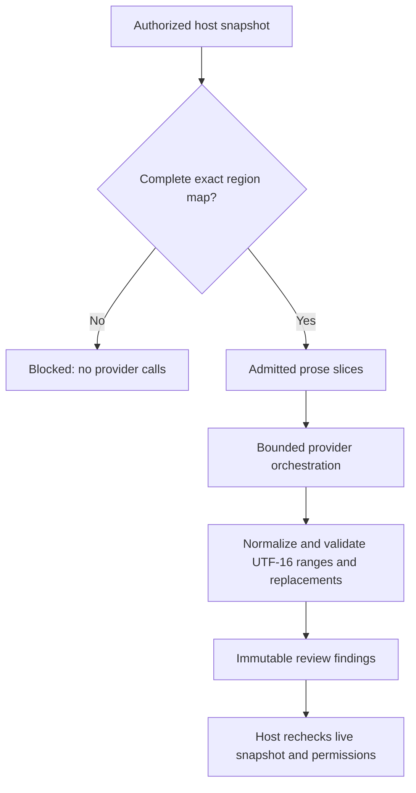

# Architecture and integration contract

A modular, deterministic-first integration library. The application is the authority for identity, tenant, record, field, revision and region classification. The library does not discover records or infer authorization.

The browser entry point is separate from the Node-only transport entry point. Load Harper/Virastar explicitly inside a host-owned worker. Optional services are deployment-owned and never fetched from a user-provided URL. Runtime permission changes invalidate the host snapshot and must terminate the worker. The package deliberately has no Apply method.

## Provider selection

| Profile | Engines | Use |
|---|---|---|
| Browser, English | Harper, optionally reviewed Textlint rules | Grammar, spelling, writing policies |
| Browser, Persian | Virastar (restricted settings) | Orthography, not full grammar |
| Document QA | Vale, STE100 | Advisory style and terminology checks |
| Self-hosted extended | LanguageTool | Optional independent grammar service |
| Experimental | Virastar TS | Evaluation only, advisory |

All proposals are source-anchored. Invalid spans, malformed results, and prohibited replacement tokens are rejected; protected slices are not sent to providers. The host must protect names and any commercial or technical facts not caught by heuristics. Security and semantic correctness are separate properties.
